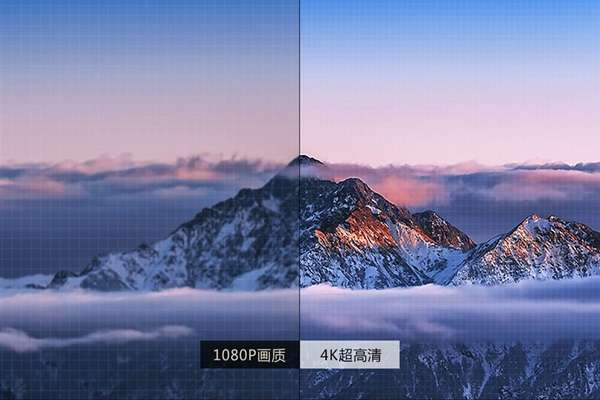

+++

date = '2026-05-17'
draft = false
math = true
title = '[十万个为什么] 画质and分辨率'
categories = ["十万个为什么"]
tags = []

+++

# [十万个为什么] 画质and分辨率

## 个人导航

知乎：https://www.zhihu.com/people/byzh_rc

CSDN：https://blog.csdn.net/qq_54636039

注：本文仅对所述内容做了框架性引导，具体细节可查询其余相关资料or源码

参考文章：各方资料

@[TOC]

## 像素

1个像素Pixel = RGB三个发光点挨在一起

## 屏幕

### 1. LED 大屏

1 个像素 = R+G+B 三颗独立 LED 灯珠

- 户外广告、舞台屏

### 2. OLED 屏

1 个像素 = R+G+B 三颗微型自发光 OLED 芯片

- 手机、高端电视、手表

### 3. LCD / 液晶屏

1 个像素 = R+G+B 三个液晶滤光单元 + 共用背光板

> 液晶本身不发光，只控制透光，靠背后统一光源照亮

## 画质

> 图例:
>
> 

画质常见分类:

- 流畅: 360P: 640x360 Pixel
- 标清: 480P: 720x480 Pixel
- 高清: 720P: 1280x720 Pixel
- 超清: 1080P: 1920x1080 Pixel
- 2K: 1440P: 2560x1440 Pixel
- 4K: 2160P: 3840x2160 Pixel

> P是高度指标
> K是宽度近似指标

> 各视频平台的习惯, 叫法均有不同(为了卖会员)

## 分辨率

同一显示屏可以调不同的分辨率

1080P屏: 代表其有1920x1080个物理像素

- 设1920×1080 -> **一个画面点 = 一个物理像素**
- 设1280×720 -> 多个物理像素合并显示一个画面点 -> 发虚、模糊、有锯齿