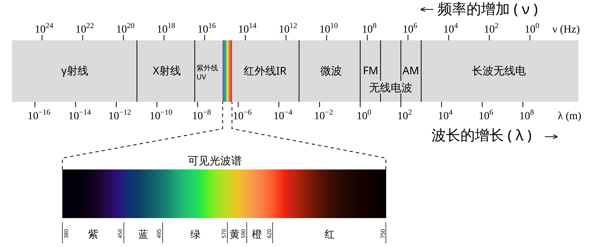

+++

date = '2026-05-17'
draft = false
math = true
title = '[十万个为什么] 眼睛怕蓝光'
categories = ["十万个为什么"]
tags = []

+++

# [十万个为什么] 眼睛怕蓝光

## 个人导航

知乎：https://www.zhihu.com/people/byzh_rc

CSDN：https://blog.csdn.net/qq_54636039

注：本文仅对所述内容做了框架性引导，具体细节可查询其余相关资料or源码

参考文章：各方资料

@[TOC]

## 蓝光

### 1. 能量角度

光的能量与其波长成反比。波长越短，单个光子所携带的能量越高。

在可见光谱（约380nm-780nm）中，**蓝光、紫光（波长380nm-500nm）处于短波端，是能量最高的可见光**。

高能量的蓝光穿透眼球时，更容易与眼内组织（特别是视网膜）的分子发生**光化学反应**，长期过量暴露可能产生氧化压力，增加视网膜细胞（尤其是对光敏感的感光细胞和黄斑区细胞）受损的风险。

### 2. 视觉角度

人眼并非对所有波长的光都能完美聚焦。

**短波蓝光的焦点会落在视网膜稍前方**，而长波红光则落在视网膜稍后方。

为了看清物体，眼睛的睫状肌需要不断进行微调（调节），努力将蓝光焦点“拉回”到视网膜上。

长时间的这样微调会导致**调节肌肉紧张和痉挛**，是引发**数字视觉疲劳**（眼睛酸胀、模糊、对焦困难）

蓝光在眼内介质（如房水、玻璃体）中**散射更严重**，这也是造成屏幕“眩光”感强、视觉对比度下降的原因

### 3. 生物角度

人眼视网膜上存在一类特殊的感光细胞——**内在光敏视网膜神经节细胞**

这类细胞**对波长为460-480纳米左右的蓝光最为敏感**。当它们接收到蓝光信号后:

- **抑制褪黑素的分泌**：褪黑素是促进睡眠的激素。白天接收蓝光有助于保持清醒，但**夜间接触蓝光会强烈抑制褪黑素，扰乱生物钟，导致入睡困难、睡眠质量下降**。
- 调节昼夜节律：蓝光是同步人体内部生物钟与外部24小时环境的最强信号。

-> **“防蓝光”在保护睡眠健康方面具有不可替代性**

### 拓: 为什么不防紫光?

紫外线（波长<380nm）能量比蓝光更高，伤害也更大，但现代电子屏幕的**玻璃面板和光学元件已经能几乎100%过滤掉紫外线**
-> 来自屏幕的紫外线风险已被基本消除

### 拓: 激光笔?

激光笔的能量高度集中, 类似放大镜汇聚的阳光 -> 高能量

当它照射到眼睛视网膜上时，眼睛自身的晶状体恰好是一个完美的**聚光透镜**，会把本已高度集中的激光束，再次聚焦到视网膜上一个**极其微小**的区域。

**视网膜瞬间烧伤**：在这个微小焦点上，**光能瞬间转化为热能**，温度急剧升高，足以**灼伤、汽化**视网膜的感光细胞，造成永久性的、不可逆的损伤。这个过程可能只需要**毫秒级**的时间。

视网膜上没有痛觉神经。被灼伤时，人**不会感到疼痛**，可能只是看到个亮斑或黑影，但损伤已经造成，为时已晚。

## 眼镜 -防蓝光

眼镜防蓝光的设计主要是为了应对现代生活中电子屏幕（如电脑、手机、平板等）发出的**短波蓝光**（波长约400-500纳米）

通过镜片镀膜或材料吸收/反射一部分蓝光，减少进入眼睛的蓝光能量。

防蓝光眼镜不能完全阻挡蓝光，也无法预防近视。

## 电脑 - 护眼模式/夜间模式

- 将屏幕色调从冷色调（偏蓝）调整为暖色调（偏黄/红），减少短波蓝光的比例
- 会同步降低屏幕亮度，减少整体光线刺激

## 行为 - `20-20-20法则`

**20-20-20法则**是一个简单易行、被眼科医生广泛推荐的缓解数字视觉疲劳（也称“电脑视觉综合症”）的用眼休息法则。

**每近距离用眼（看电脑、手机、看书等）20分钟，就抬头向20英尺（约6米）以外的远处，眺望至少20秒钟。**
(搭配眨眼补水)

## 行为 - 眼保健操

> 做操前务必**彻底洗手**，**防止将细菌带入眼睛**

规范手法按摩眼眶周围的穴位（如睛明、四白、太阳穴等），刺激神经末梢，**放松眼轮匝肌、睫状肌等紧张的眼部肌肉**

**促进局部血液循环**：按摩有助于加速眼周血液循环，增加眼部供血和营养

**强制休息**：做操的几分钟里，眼睛是闭上的，避免了持续注视，让眼睛得到短暂的**彻底休息和泪液均匀分布**的机会

